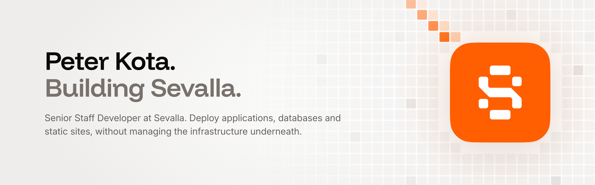

<picture>
  <source media="(prefers-color-scheme: dark)" srcset="assets/banner-dark.png" />
  
</picture>

I'm a Senior Staff Developer at [Sevalla](https://sevalla.com/?utm_source=github&utm_medium=profile), the platform for deploying applications, databases and static sites, without managing the infrastructure underneath. Underneath, it's Kubernetes, Google Cloud and Cloudflare. On top, it's a `git push`.

[Sign up](https://sevalla.com/signup?utm_source=github&utm_medium=profile) · [Docs](https://docs.sevalla.com/?utm_source=github&utm_medium=profile) · [API reference](https://api-docs.sevalla.com) · [Status](https://status.sevalla.com) · [X](https://x.com/sevalla_hosting)

## Sevalla

<a href="https://sevalla.com/?utm_source=github&utm_medium=profile">
  <picture>
    <source media="(prefers-color-scheme: dark)" srcset="https://assets.sevalla.com/screenshots/dark/app-overview.png" />
    
  </picture>
</a>

| Product | What it is |
| ------- | ---------- |
| **Application hosting** | From GitHub, GitLab, Bitbucket or any Docker registry: if it runs in a container, it runs on Sevalla. |
| **Database hosting** | PostgreSQL, MySQL, MariaDB, Redis and Valkey, with automated backups and Database Studio. |
| **Static site hosting** | Blogs, docs and landing pages, served from Cloudflare's edge network. |
| **Object storage** | S3-compatible buckets for assets, media and files, for any S3 client or SDK. |
| **Pipelines** | Preview environments for pull requests, and promotion from one stage to the next. |

### Tools I've built for Sevalla

| Repository | What it does |
| ---------- | ------------ |
| [`mcp`](https://github.com/sevalla/mcp) | Sevalla's remote MCP server: deploy, debug and manage Sevalla from any AI agent. |
| [`cli`](https://github.com/sevalla/cli) | Deploy and manage applications, databases and static sites on Sevalla from your terminal. |
| [`sevalla-deploy`](https://github.com/sevalla/sevalla-deploy) | Deploy and promote Sevalla applications and static sites from GitHub Actions. |
| [`terraform-provider-sevalla`](https://github.com/sevalla/terraform-provider-sevalla) | Manage Sevalla applications, databases, static sites and more with Terraform. |

## Lumovi

Sevalla runs on Kubernetes, so we watch a lot of clusters. I wanted to see how they're doing at a glance, so I built **[Lumovi](https://lumovi.dev)** (it was called KubeStacks): a free, open-source Kubernetes dashboard, on your desktop for every cluster in your kubeconfig, or in your cluster for your whole team. It shows what's healthy, what's struggling and where your capacity goes, and helps you fix things safely.

<a href="https://github.com/Lumovi/Lumovi">
  <picture>
    <source media="(prefers-color-scheme: dark)" srcset="https://raw.githubusercontent.com/Lumovi/Lumovi/main/docs/screenshots/overview-dark.webp" />
    
  </picture>
</a>

**[Download for macOS, Windows or Linux](https://github.com/Lumovi/Lumovi/releases/latest)** · [Install in a cluster](https://docs.lumovi.dev/server/install) · [Source](https://github.com/Lumovi/Lumovi)
